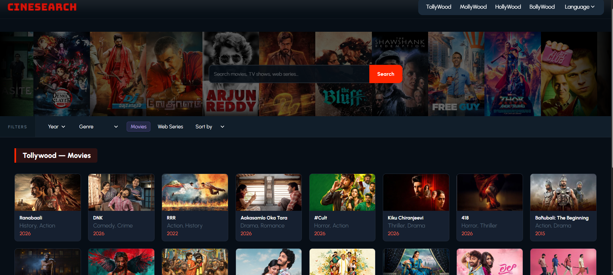
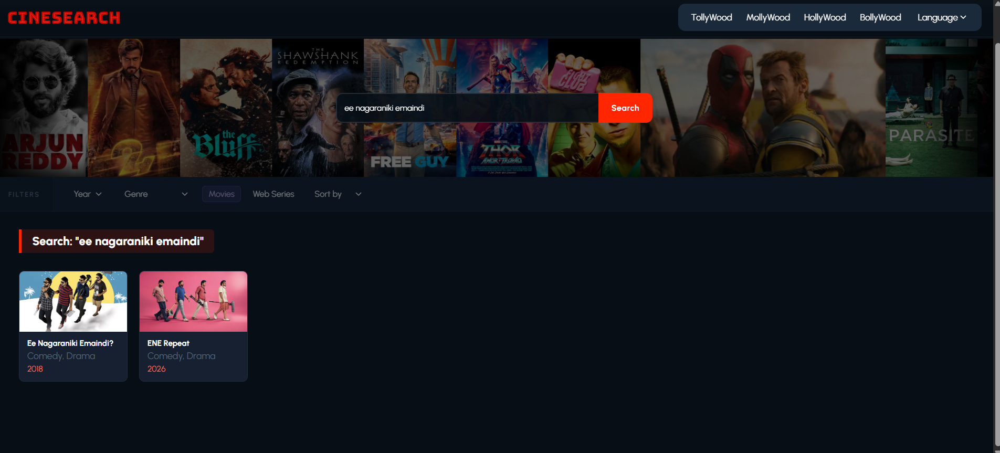
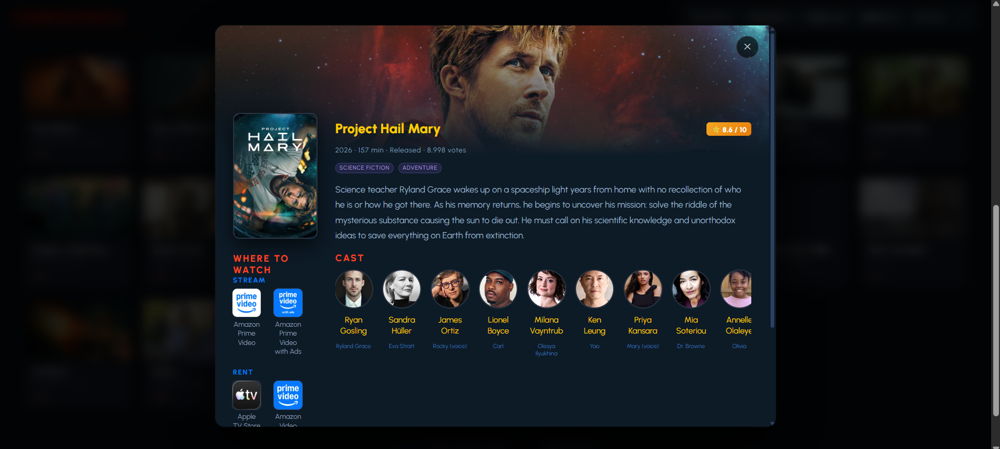
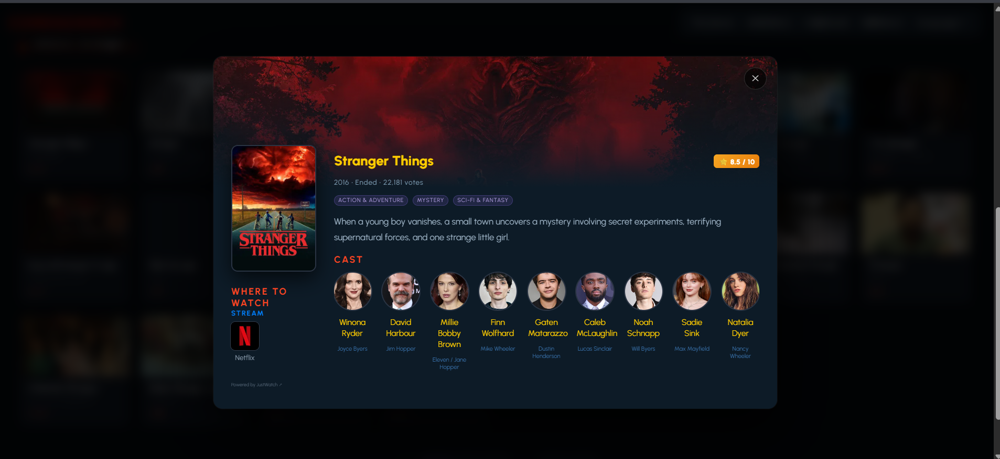

# 🎬 CineSearch

A simple movie and web series finder. Search titles, filter by industry, language, year and genre, and see cast and where to watch.

## Demo






## Features

- Browse Tollywood, Mollywood, Hollywood and Bollywood
- Search movies and web series
- Filter by year, genre, language, and sort by rating or latest
- Detail popup with cast and streaming platforms
- "For You" recommendations based on what you view and search

## Tech

HTML, CSS, JavaScript and the [TMDB API](https://www.themoviedb.org/documentation/api).

## Run locally

No install needed. Put all files in one folder and start a local server:

```
python -m http.server 8000
```

Then open http://localhost:8000

## Setup

Replace `API_KEY` on line 1 of `cc.js` with your own free TMDB API key.
